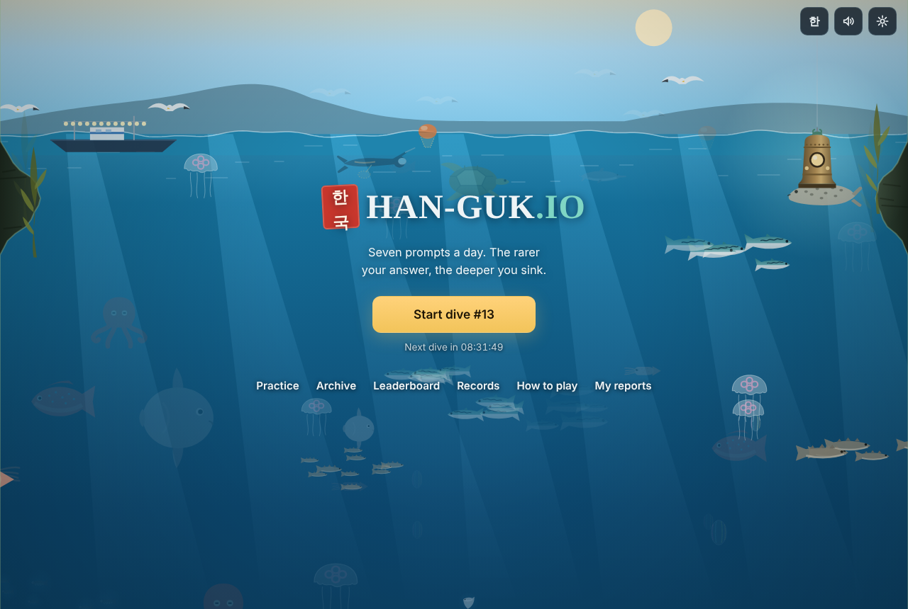
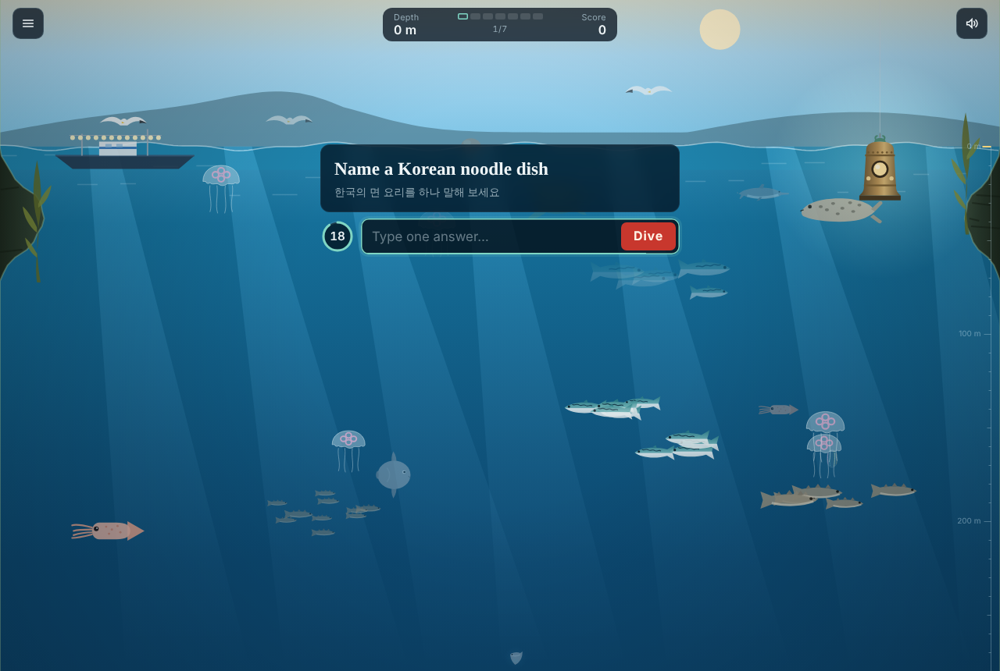
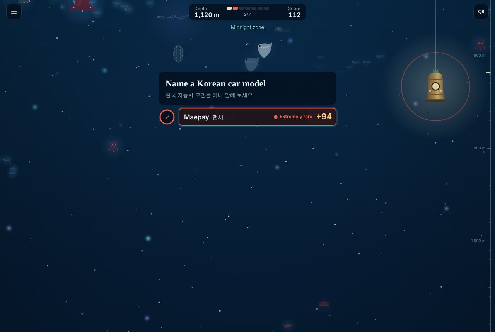
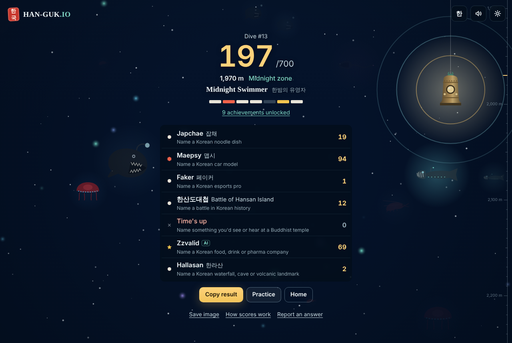
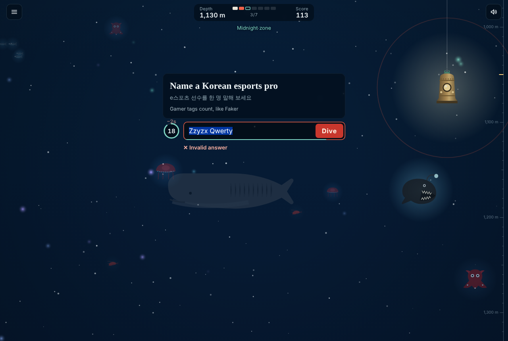
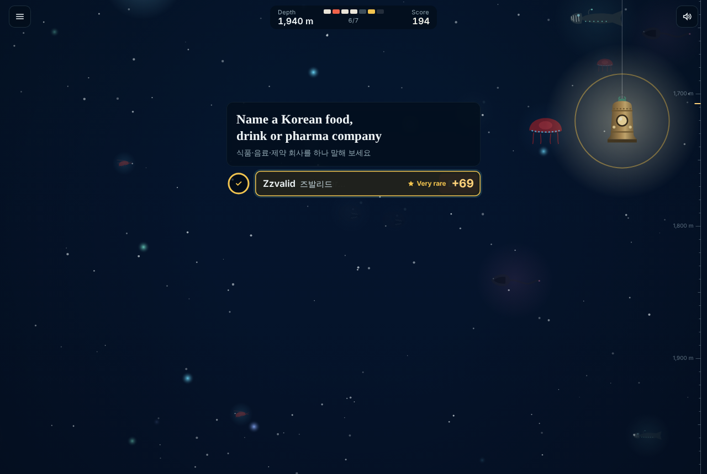
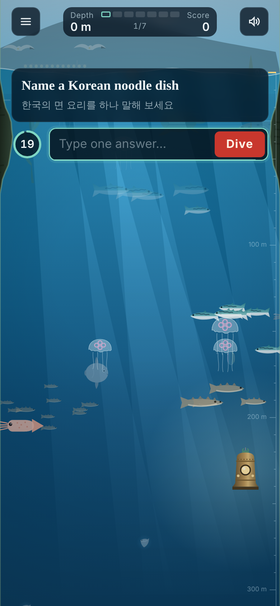

# HAN-GUK.IO · 한국 심해 탐사

**The Korean Deep Dive.** A daily trivia game about Korea: seven prompts, twenty seconds each. Keep
trying until an answer counts (each wrong try costs two seconds); valid answers that fewer people
would think of score more, and every point sinks your diving bell ten metres deeper, from the sunlit
surface off Jeju to the Dragon King's palace at the bottom of a 7,000 m trench. Answers the answer
bank doesn't know are checked by an AI judge (Claude).

Inspired by the rarity-scoring idea and the minimal play screen of Krillion.io; built from scratch
with its own name, art, sound, content and code. Not affiliated with Krillion.



| A prompt | A result | The results |
|---|---|---|
|  |  |  |

| A wrong try | An answer judged by Claude (test run, fake judge) | Phone |
|---|---|---|
|  |  |  |

## What's in the box

- **The game**: daily dive (same seven prompts for everyone, picked deterministically per KST date,
  no rerolls) on a minimal screen: a small HUD (depth, seven progress stripes, score), a compact
  prompt box, a one-line answer field right under it with a ring timer, and nothing else. Multiple
  tries per prompt with a 2-second penalty per wrong try and a short label ("Already used",
  "Doesn't fit"...). Feedback is one line in the field's place (answer, rarity mark, points), then
  the next prompt opens by itself; no answer keys, no explanations. Results with score, depth,
  title, the seven answers and their points, real leaderboard rank only, spoiler-free share text
  and a PNG share card. Archive of past dives, practice mode (pick categories, prompt count, timer
  or untimed with Pass), personal records, streaks and 28 achievements, English and Korean UI,
  keyboard play, reduced motion, high contrast, separate music and effects volumes.
- **The answer bank**: 285 bilingual prompts across 12 categories, 5,944 accepted answers and
  23,805 accepted spellings (Hangul, Revised Romanization variants, common alternative spellings,
  English translations where a prompt allows English). The official schedule is frozen two weeks
  ahead so content edits never rewrite a published dive. See [docs/CONTENT.md](docs/CONTENT.md) and
  the generated [content/REPORT.md](content/REPORT.md).
- **Transparent scoring**: `points = clamp(round(25 × log10(1/p)), 1, 100)`, with p from a curated
  estimate until enough real answers exist, then blended with observed answers (never your own).
  See [docs/SCORING.md](docs/SCORING.md).
- **Validation**: Unicode/IME normalization, romanization folding, typo tolerance only when a typo
  points at exactly one answer, and a short label for every wrong try. Answers the bank can't
  place go to an **AI judge** (Claude Haiku 5.5 by default) that rules on them, names them and
  rates how common they are; its ruling is mapped back onto the bank so respelling a common answer
  can't buy points, and the bank's rules (exclusions, closed lists, Korean-word prompts) always
  win. Rulings are shared so everyone is judged alike, moderators can block AI-accepted answers,
  and players can still send rejected answers to a review queue.
- **The ocean**: a canvas scene with 48 original SVG illustrations (haenyeo, squid boats, mackerel,
  pollack, anglerfish, vampire squid, dumbo octopus, sea pigs, vents, snailfish, Yonggung and its
  dragon...), light shafts, marine snow, bioluminescence, slope and trench walls, and a finale for a
  perfect 700. See [ASSETS.md](ASSETS.md).
- **Sound**: synthesized at run time (WebAudio): ambience that darkens with depth, a gayageum-like
  plucked string, a temple bell, bubbles, ticks. No samples.
- **Reference server** (`server/`): Node + built-in SQLite. Authoritative timers and scoring, the
  AI judge on the operator's API key, one daily per player, live answer statistics,
  daily/weekly/all-time leaderboards, rate limiting and a moderated review queue.
- **Tests**: 152 unit and integration tests, plus a headless-browser test that plays a full
  seven-prompt dive (a wrong try, an AI-judged answer and a timeout included) against a fake
  Claude API and checks the layout rules on desktop and phone sizes (compact column, field right
  under the prompt, no scrolling, short feedback with no answer key). See [Testing](#testing).

## Run it

Requirements: Node.js 22.5 or newer (for `node:sqlite`). Python 3 + Playwright only for the browser test.

```bash
npm install          # react, react-dom; dev: esbuild, tsx, typescript, @types/node
npm run build        # compile content, export assets, build dist/
```

Then pick one:

1. **Just play locally**: open `dist/index.html` in a browser. Everything runs in the page; records
   are kept in this browser; no leaderboard. For AI answer checking, paste an Anthropic API key in
   Settings (kept in the browser, sent only to api.anthropic.com).
2. **Full stack**: `npm run server` and open http://localhost:8787. The page detects the server and
   switches to server mode: the server keeps the clock, scores every answer, keeps one official dive
   per player and runs the leaderboards. Set `ANTHROPIC_API_KEY` for AI answer checking and
   `ADMIN_TOKEN` to use the review API; see [docs/DEPLOY.md](docs/DEPLOY.md) for production (TLS
   proxy, `TRUST_PROXY`, backups).
3. **On claude.ai**: publish `dist/hanguk-io.artifact.html` as an artifact with the capabilities in
   [docs/DEPLOY.md](docs/DEPLOY.md). Viewers get a private cloud profile, a shared leaderboard and
   review queue among the people who can open the page, and AI answer checking on their own Claude
   account (asked once); the owner gets an approval screen and can block AI-accepted answers.

`npm run dev` builds unminified and serves on http://localhost:5173.

## Testing

```bash
npm test             # 138 game/content/judge tests + 14 server tests (node:test)
npm run typecheck    # tsc --noEmit
npm run content:check
npm run e2e          # headless Chromium: plays a full daily dive and more (needs a build)
node scripts/mock-claude.mjs 8790 &                  # a fake Claude API for the server run
ANTHROPIC_API_KEY=test ANTHROPIC_BASE_URL=http://127.0.0.1:8790 npm run server &
python3 scripts/e2e.py --url http://localhost:8787/   # the same against the server
```

The suites cover normalization (NFC/NFD, full-width IME input, zero-width characters), Hangul
romanization, aliases, valid and invalid answers, rarity maths, zero and maximum scores, timer expiry
and the grace window, wrong tries, penalties and passing, the AI judge (eligibility, mapping rulings
back onto the bank, exclusions, closed lists, the Korean-word check, paused clock, budgets, cached
and blocked answers, outages), the judge's prompt, JSON parsing and Claude API client, duplicate
submissions, deterministic dailies and cooldowns, KST date boundaries, the frozen schedule and
stable history when content grows, persistence and resume, results, leaderboard ties, the content
schema and compiler checks, the review-queue export, and the server's API, auth, timing, run
locking, shared AI rulings, statistics, rate limits and moderation.

The browser test plays the daily the way a player would and also holds the play screen to its
layout rules: a 350–500 px column, the answer field directly under the prompt, a timer that counts
down, one short line of feedback with no other answers anywhere on screen, prompts that advance by
themselves, no scrolling during the dive or on the results (1280 × 860 and 390 × 844), and on a
phone the prompt, field and timer in the top half of the screen, clear of the keyboard.

## Layout

```
src/core/      rules shared by browser, server, scripts and tests (framework-free TypeScript)
src/ui/        React UI, canvas ocean (art/), WebAudio (audio.ts), platform adapters
server/        reference server (node:http + node:sqlite) and its tests
content/       answer pools (pools/*.psv), prompts (prompts/*.json), schedule.lock.json, REPORT.md
scripts/       content compiler, asset manifest, CSV import, build, end-to-end test
assets/        exported SVGs and manifest.json (generated)
docs/          SCORING, CONTENT, DEPLOY, FEATURES, screenshots
dist/          built pages (generated)
```

## Status

Everything listed above works and is tested. What is deliberately limited or still to do is listed
honestly in [docs/FEATURES.md](docs/FEATURES.md), including: the answer bank (and the Korean UI
text) is an AI-assisted draft that needs human editorial review before a public launch; in the
artifact and standalone editions scores are computed in the player's browser; rarity uses curated
estimates until real players arrive; the AI judge can be wrong and was tested against fakes, not the
live Claude API; no `package-lock.json` yet (the build machine had no npm registry access), so run
`npm install` once with access and commit the lockfile.

## License

MIT ([LICENSE](LICENSE)) for code, content files and the original art and sound. Fonts: SIL OFL
1.1 (loaded from Google Fonts with system fallbacks). React: MIT.
